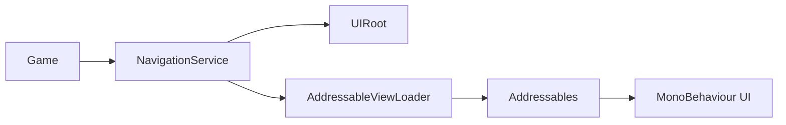

# Simple MXEngine Architecture Review

This document describes the Simple MXEngine branch. The framework intentionally
does not use Presenter, View, or ViewState classes.

## Boundaries

`NavigationService` owns screen, modal, and overlay collections. `UIRoot` owns
the three Unity hierarchy layers. `AddressableViewLoader` owns each
Addressables instance handle from load through release. A game UI component
owns its own fields, buttons, local state, and Unity lifecycle.

## Navigation safety

Screen and modal requests share a serialized gate. Overlay requests use a
separate gate so a loading overlay can be shown while a screen is loading.
Cancellation is linked to the service lifetime and is checked before commit.
Synchronous callbacks during managed activation and loader calls fail immediately
through `LifecycleContext` if they request navigation.
This avoids waiting on a gate held by the callback's own operation. Deferred
Unity destruction callbacks run outside this synchronous guard.

Opening a new screen prepares it inactive. The service changes navigation state
and activates the new instance only at commit. A failed request restores the
previous screen. A committed replace keeps the new screen even if cleanup of
older screens fails; those releases remain tracked for retry.

## Resource ownership

The loader keeps a component-to-handle registry. A handle is removed only after
`Addressables.ReleaseInstance` succeeds. Cancelled or failed loads retain their
unfinished handle until the operation completes, then release it and destroy
the staging object. `RetryPendingCleanup` handles failed abandoned-load cleanup.

`NavigationService` similarly tracks failed instance releases in
`PendingReleaseCount`. Call `RetryPendingReleasesAsync` after correcting the
underlying release problem. UI components must not release their own
Addressables handles.

## Verification scope

The navigation suite contains 19 tests for screen stack/reorder/replace and
back navigation, modal stacks, overlay duplicate keys, failed loads,
cancellation, concurrent channels, shutdown, and retryable cleanup.
The Addressables integration test verifies independent instances/handles and
inactive staging when loading the same key repeatedly.

## Logic fixes on Simple

- Back navigation activates the previous screen before awaiting release, and
  restores history/current visibility if activation or cancellation fails.
- Failed screen activation hides the new screen before reactivating the old
  one, so recovery callbacks do not observe both screens active.
- Shutdown aggregates cancellation-callback errors but still drains owned UI
  and resolves its shared completion; repeated callers cannot wait forever.
- Destroyed Unity components returned by a loader still have their managed
  ownership released. Activation rejects destroyed views/inactive parents.
- Synchronous loader callbacks (including immediate destruction) receive the
  same reentrancy guard as activation. The guard is never held across an await.
- The scene-owned sample controller rejects duplicates and clears its static
  instance on destruction. The demo does not shut down a service it only uses.
- Gameplay navigation no longer loads another additive scene on every click.
- The demo builder no longer looks up a removed `NavigationDemo.uiRoot` field;
  the stored scene uses the controller's current assembly and namespace.
- Test helpers use UniTask's awaiter completion API and a correctly accessible
  fake-loader field, fixing compilation errors in the previous test suite.

Validation in this change: runtime and navigation tests were compiled with
Roslyn against UniTask 2.5.11 and NUnit 3.13.3, then all 19 navigation tests
passed in a temporary .NET harness with Unity API shims. This is a logic check,
not a Unity Editor/Player or Addressables runtime run.

Before merging, run the Unity Test Runner on Unity 6000.3.19f1, including the
Addressables integration test. Rebuild the demo through `MXEngine > Build
Navigation Demo Scene`, exercise screen/back/modal/overlay buttons, and reload
its scene to verify controller ownership and scene teardown in the real engine.
