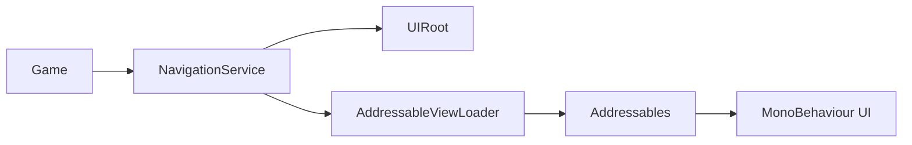

# Simple MXEngine Architecture Review

This document describes the Simple MXEngine branch. The framework intentionally
does not use Presenter, View, or ViewState classes.

## Boundaries

`NavigationService` owns screen, modal, and overlay collections. `UIRoot` owns
the three Unity hierarchy layers. `AddressableViewLoader` owns each
Addressables instance handle from load through release. A game UI component
owns its own fields, buttons, local state, and Unity lifecycle.

## Navigation safety

Screen and modal requests share a serialized gate. Overlay requests use a
separate gate so a loading overlay can be shown while a screen is loading.
Cancellation is linked to the service lifetime and is checked before commit.
Requests from a UI lifecycle callback fail immediately through `LifecycleContext`
instead of waiting on a gate that the callback's request already holds.

Opening a new screen prepares it inactive. The service changes navigation state
and activates the new instance only at commit. A failed request restores the
previous screen. A committed replace keeps the new screen even if cleanup of
older screens fails; those releases remain tracked for retry.

## Resource ownership

The loader keeps a component-to-handle registry. A handle is removed only after
`Addressables.ReleaseInstance` succeeds. Cancelled or failed loads retain their
unfinished handle until the operation completes, then release it and destroy
the staging object. `RetryPendingCleanup` handles failed abandoned-load cleanup.

`NavigationService` similarly tracks failed instance releases in
`PendingReleaseCount`. Call `RetryPendingReleasesAsync` after correcting the
underlying release problem. UI components must not release their own
Addressables handles.

## Verification scope

The Unity tests cover screen stack/reorder/replace and back navigation, modal
stack behavior, overlay duplicate-key handling, failed loads, cancellation,
concurrent requests, shutdown, and retryable cleanup. The Addressables
integration test verifies that repeated loads of one key produce independent
instances with independent handles.
